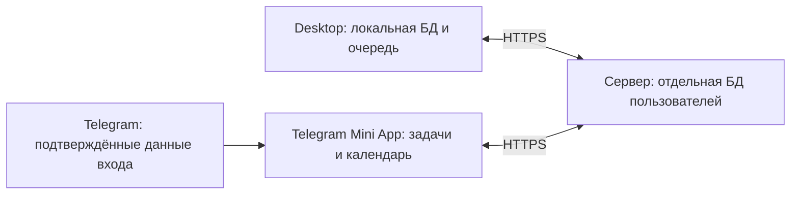

# Синхронизация и Telegram — предложение T41a

Статус: **предложено 26 ноября 2026, ожидает согласования**. Это проект
контракта, не реализованный сервер/аудит/развёртывание. S16 остаётся источником
уже принятых требований; новые решения ниже не считаются принятыми автоматически.

## Что требуется согласовать

1. Для первого варианта — HTTPS и изоляция пользователей без сквозного
   шифрования. Сервер обрабатывает читаемые задачи; владелец сервера и человек
   с доступом к его БД технически могут прочитать содержимое. Шифрование диска
   и серверных копий не устраняет этот доступ во время работы приложения.
   Альтернатива — отдельный проект сквозного шифрования с ключами на устройствах,
   восстановлением доступа и моделью доверия к коду Mini App; это не небольшой
   переключатель, добавляемый после готового протокола.
2. Кроме задач/календаря включить категории как связанный справочник. Иначе
   `category_id` из существующей Task не сможет ссылаться на одинаковую
   категорию на разных устройствах. Файлы/фокус/сад/ИИ не включать.
3. Первое подключение — резервная копия и предварительный просмотр объединения.
   Разные UUID добавляются; одинаковые UUID с разным содержимым требуют выбора
   источника, без безусловной перезаписи всего профиля. Обычная последующая
   синхронизация использует уже принятый порядок сервера.

Остальные численные параметры — предложенные настройки v1, не факты об API
Telegram: сроки сессий/кодов, ограничения и срок серверных копий можно изменить
при согласовании. Домен/размещение/бюджет и путь закрытого репозитория потребуются
перед отдельным этапом развёртывания, сейчас они не блокируют обсуждение.

## Границы и размещение

- Desktop сохраняет Python/PySide6/QML/SQLite; регистрация не нужна для локальной
  работы. Отключение сервера не прекращает создание/редактирование задач.
- Предлагаемый начальный сервер: Python/FastAPI и SQLite, один процесс приложения,
  последовательные короткие транзакции записи; БД не на сетевом диске. Очереди,
  лимиты и отзывы находятся в БД, а не только в памяти. Перед несколькими
  процессами/большой нагрузкой — отдельная проверка и переход к PostgreSQL.
- Сервер — отдельный закрытый репозиторий, не папка backend внутри desktop.
  Тут остаются контракт/клиент/обезличенные примеры. Секреты/живые данные не
  коммитятся даже в закрытом репозитории. Новый репозиторий пока не создаётся.
- Mini App — компактный веб-интерфейс задач/календаря, открываемый через бота;
  настольный клиент не становится веб-сервером. Чтения сообщений Telegram нет.
- Внешний доступ только с HTTPS и корректным сертификатом. Временный второй
  компьютер допустим; его сон/отключение делают Mini App недоступным. Порт БД
  наружу не открывается. Публикация, настройка ОС/домена и расходы — отдельно.

## Состав передаваемых данных

| Единица обмена | Содержимое |
| --- | --- |
| Главная задача | UUID, название/описание, выполнение, сложность, ожидаемое время, дедлайн, ссылка категории, порядок/UUID/веса веток и пунктов |
| Корзина главной задачи | Состояние корня и записи удаления его веток/пунктов с UUID, временем и структурными снимками до/после; один агрегат с задачей |
| Календарь | UUID, начало/конец, UUID главной задачи либо название самостоятельного события |
| Категория — предложено | UUID/название и состояние удаления; отдельная единица обмена |

Не передаются файлы и их имена/пути/связи, фокус/ручной учёт времени/Pomodoro,
сад/достижения/валюта, история ИИ/навыки/подключения, ключи, Gmail/Telegram
сообщения, настройки и рабочие часы. Ссылки, вручную написанные в описании,
остаются частью описания; служебные связи с источниками Gmail не включаются.
Текст задачи сам может содержать личную информацию — облако получает его
после явного включения синхронизации, а не автоматически при регистрации.

Существующий storage/codec.py — кодек локальной корзины, не готовый сетевой
контракт. В v1 нужен отдельный строгий DTO с белым списком полей. Decimal-веса
передаются строками, ожидаемое время — строкой целого числа микросекунд,
даты — ISO8601 со смещением и сохранением микросекунд. Ревизии/курсоры — строки.
Это предотвращает потери точности в JavaScript. UUID потомков/порядок/nullable
дедлайн сохраняются; календарные интервалы сопоставляются по UTC. Отображение
местного времени зависит от устройства, настройки часового пояса не синхронизируются.

## Вход в Mini App

- Mini App передаёт исходное initData серверу в теле HTTPS-запроса. Сервер
  проверяет его по официальному алгоритму Telegram, извлекает user.id только
  после проверки; отсутствие корректного user/id означает отказ. initDataUnsafe и присланному отдельно owner/user_id не доверяет.
  Токен бота остаётся на сервере; не нужен в desktop или JavaScript.
- Срок initData — предложено 5 минут, допустимое будущее смещение 30 секунд.
  Повторы определяются отпечатком проверенного нормализованного содержимого,
  а не порядком параметров исходной строки; дубликаты ключей отклоняются.
- Каждый вход создаёт сессию, а не передаёт initData при каждом запросе.
  Mini App получает случайный access-токен на 30 минут, хранит только в памяти,
  не localStorage/URL/логах/Telegram CloudStorage. После истечения/перезагрузки,
  если initData уже использовано, пользователь переоткрывает Mini App в Telegram.
- Внутренний owner UUID связан с Telegram ID (не username/номером телефона).
  Имя, фото, контакты и чаты для регистрации не сохраняются. Авторизация
  по Telegram не предоставляет доступа к его перепискам.

Адрес сервера задаётся явно и виден перед отправкой кода привязки. API-клиент
не переносит токены/initData на другой origin через redirect. Копируемый код
не является разрешением заменить адрес сервера или выполнить команду.

Проверка подписи и наличие аккаунта не разрешают операции над чужими объектами:
каждый запрос отдельно связывается с owner из действующей сессии.

## Подключение desktop

1. В Mini App пользователь выбирает «Подключить компьютер». Сервер создаёт
   случайный одноразовый код не менее 128 бит, срок 5 минут. Это копируемая
   строка, не короткий угадываемый PIN; в БД хранится только её хеш.
2. Desktop принимает код, создаёт случайный секрет подтверждения, отправляет
   его SHA-256 challenge и имя устройства. Сервер создаёт ожидающий запрос,
   не выдаёт постоянную сессию только за знание кода.
3. Mini App показывает ожидающее устройство и короткий отпечаток, видимый
   также на desktop. Пользователь сверяет его и подтверждает на телефоне.
   Имя компьютера не является доказательством личности.
4. Desktop доказывает знание секрета подтверждения и получает свои access и
   refresh-токены. Код расходуется атомарно; получатель фиксирован challenge.
   Потеря ответа при одноразовой выдаче требует нового подключения, повторная
   отправка кода не выдаёт второй комплект токенов.
5. Access действует 15 минут. Refresh — 30 дней бездействия, максимум 90 дней
   от привязки, ротация при использовании; повтор старого refresh отзывает
   семейство сессий. Клиент сериализует refresh; при потерянном ответе ротации
   может потребоваться повторная привязка. Токены случайные, в серверной БД
   только хеши. Проверка отзыва устройства обязательна и при живом access.
6. Desktop хранит refresh только в проверенном защищённом хранилище ОС;
   без него — в памяти до закрытия, с понятным сообщением. Не plaintext-файл,
   не tasks.sqlite3, не backup. Windows проверяется отдельно до выпуска.

Mini App показывает устройства и позволяет отозвать любое/все. Отозванное
устройство сохраняет локальные задачи, но сервер больше не принимает/не выдаёт
ему данные. Уже скачанные копии удалённо стереть нельзя. Одна облачная учётная
запись на локальный профиль; вход другого человека требует отдельного профиля
или явного отдельного сценария переноса, не автоматической отправки прежних задач.

## Последовательность изменений и конфликты

Обычные правки одной сущности: **последняя принятая сервером побеждает**.
Дата устройства не определяет победителя. Операция с тем же UUID и тем же
содержимым возвращает прежнюю квитанцию, не становится новым изменением.
Тот же UUID с другим содержимым отклоняется. Квитанция ищется после проверки сессии/владельца, до проверки свежести
сущности. Её старый снимок не откатывает локальное состояние с большей
ревизией. Квитанции привязаны к owner и устройству; в v1 их минимальные записи не удаляются без отдельной политики.

- Единица задачи — весь корень с двумя уровнями и его структурной корзиной;
  не поле и не весь профиль. Разные задачи/события не перезаписывают друг друга.
- Для удаления/восстановления действует дополнительный барьер: счётчик удаления
  корня увеличивается при изменении состава его корзины. Обычный снимок,
  основанный на прежнем значении, отклоняется. Воскресить удалённую ветку или
  корень может только явное восстановление актуальной записи корзины.
- Окончательное удаление оставляет минимальную отметку UUID/поколения без текста.
  Обычное редактирование/повтор старой операции её не отменяет. UUID окончательно
  удалённых корней/потомков не переиспользуются; новая работа получает новые UUID.
- Устаревшая правка, отклонённая барьером, остаётся в очереди «требует решения».
  Нельзя автоматически заменить ей базовый счётчик на новый и отправить снова.
- Подзадачи — часть снимка корня, поэтому две параллельные правки разных веток
  одной задачи могут вытеснить друг друга по принятому правилу. UI показывает
  конфликт/источник и не обещает слияния каждого поля.

| Сценарий | Ожидаемый результат |
| --- | --- |
| ПК и телефон меняют разные главные задачи | Сохраняются обе правки |
| Телефон позже меняет тот же корень | Побеждает последняя принятая операция; клиент видит конфликт ревизий |
| Ответ потерян, ПК повторяет тот же op_id | Прежняя квитанция, без новой ревизии/выплаты/перестановки в очереди |
| Телефон удалил пункт, ПК прислал старое дерево | Отказ по барьеру удаления, пункт не возвращается |
| После purge пришла старая копия | Отметка окончательного удаления блокирует возврат |
| Два разных события пересеклись | Оба сохранены, предупреждение о пересечении как в desktop |

Рабочие блоки главной задачи при её переносе в корзину сохраняются скрытыми,
как сейчас в SQLite, и снова видны после восстановления. При окончательной
очистке задача и её блоки удаляются одной серверной транзакцией с отдельными
ревизиями/отметками каждого блока. Подтверждение удаления/восстановления
проверяет актуальную ревизию; при гонке требуется повторный просмотр.
Удаление самостоятельного события/блока оставляет только служебную отметку,
новой пользовательской корзины календаря v1 не вводит.

Категории: удаление обнуляет ссылки в задачах одной транзакцией и выдаёт
ревизии всем затронутым корням; устаревшая ссылка не создаёт категорию заново.
Неизвестные/чужие root/category UUID в блоках/задачах отклоняются.

## Desktop: очередь и восстановление связи

Локальная правка и запись операции в outbox — **одна транзакция tasks.sqlite3**.
Токенов в outbox нет. Замороженная операция содержит op_id, устройство/облачное
поколение, тип/UUID сущности, основание (ревизия/счётчик удаления) и payload.
Новые правки той же задачи не переписывают уже отправленный op_id.
При включённой синхронизации очередь пополняется локально и без сети.

После соединения: получить квитанции повторяемых операций, отправить очередь
в исходном порядке, получить изменения после курсора и применить их с учётом
ещё не подтверждённых локальных правок. Входящие данные не превращаются обратно
в исходящие операции. Серверный снимок и локальные ожидающие правки разделены;
входящие изменения не затирают необработанный локальный ввод. Отклонённые
операции не исчезают молча. Retry/backoff ограничен, есть ручной повтор/статус.

Пакет ответов/квитанций/новый курсор применяются локально атомарно. Сервер
назначает монотонные номера из БД, фиксирует изменение/эффекты/квитанцию
атомарно. Курсор выдаёт согласованную страницу без пропуска конкурирующих
записей. Для связанных корня/корзины/блоков виден весь пакет транзакции.
При устаревшем/чужом курсоре — полный согласованный снимок без удаления outbox,
а не отправка старой общей БД на сервер.

Временные таблицы очереди/облачного снимка/курсоров очищаются только в копии
БД при создании обычного backup; рабочая БД не меняется. Токены и привязка
не копируются. После restore локальной копии синхронизация требует повторного
сопоставления с облаком; старая очередь не запускается автоматически.
Первое подключение/смена сервера/поколения — backup и предпросмотр, без
автоматического принятия локального профиля за самую свежую общую версию.

Входящие облачные данные не приносят чужой фокус/кошелёк/сад. Первая привязка и
полный resync не должны выдавать повторные награды за уже известную историю.
Учёт новых выполнений с другого устройства для локального сада — открытый
вопрос до T41c: нельзя молча включить существующие garden_event для каждого
входящего снимка, как и молча лишить пользователя наград за новую работу.
Нужны согласованный origin/идемпотентность и отдельные сценарии проверки.
До решения подключение inbound к реальным начислениям не реализуется.
Аналогично до T41c уточняется судьба локальных вложений при удалённом purge:
утрата облачной ссылки на узел сама по себе не разрешает молча уничтожить
локальный файл. Первичный импорт не удаляет файлы; отдельная политика
сохранения/ручной очистки должна быть проверена до применения живых данных.

## Защита сервера и данные

- Сервер сам выводит owner из сессии, не из payload. Все запросы/ссылки/страницы/
  курсоры/квитанции/удаления проверяют owner; нет свободных SQL/путей/команд.
- Явные схемы/лимиты: тело sync-пакета 2 МиБ, до 50 операций (большие деревья
  идут отдельными пакетами); пагинация полного снимка. Размер дерева и длины
  текста сверяются с действующими domain/application-валидаторами до выбора
  финальных лимитов, не урезаются молча. Неподдерживаемая версия отклоняется.
- Предложенные начальные лимиты: код — 5 попыток в минуту по IP/запросу,
  выдача кодов — 5 за 10 минут по учётной записи; sync — 60 запросов в минуту
  на устройство с burst 10. Ограничения хранятся на сервере, Retry-After.
- Мини App получает только нужные API; точный Origin/CORS, строгий CSP и вывод
  названий/описаний как текста. Секреты не в URL. Собственные токены не в
  localStorage; кража токена через XSS остаётся риском, нужны отдельные проверки.
- Токен бота/ключи TLS и шифрования backup — вне Git и рабочего каталога Mini App.
  Журналы содержат технические ID/коды ошибок, не тела задач/initData/токены/коды.
  Приватный Git сам по себе не защищает работающий сервер.
- Предложено 7 ежедневных зашифрованных серверных копий вне публичной папки,
  ключ хранится отдельно. Пока backup не реализован/не восстановлен в тесте,
  использовать сервер с личными данными нельзя считать проверенным сценарием.
- Удаление облачного аккаунта отзывает все сессии и удаляет рабочее содержимое;
  старые копии уходят по ротации в пределах 7 дней. Служебная отметка удаления
  сохраняется отдельно, чтобы restore не воскресил удалённый аккаунт. Restore
  сервера — специальная операция: применение актуальных отметок удаления,
  смена поколения сессий, повторная привязка устройств/полный resync; до открытия
  API проверяется, что отозванные токены и удалённые аккаунты не восстановлены.

## Этапы после согласования

| Этап | Граница и готовность |
| --- | --- |
| T41b | Строгие клиентские DTO/операции/примеры; без сервера/личных данных, тесты сериализации и всех конфликтных сценариев |
| T41c | Outbox/inbox/cursor и миграции/backup desktop; до inbound согласовать сад/локальные вложения, затем транзакционность и restart/restore |
| T41d | Код сервера в отдельно согласованном закрытом репозитории: Telegram-вход/привязка/изоляция/ревизии/отзыв/лимиты, два fake-пользователя |
| T41e | Панель desktop, проверенный vault Linux/Windows, явное подключение/отключение и resync, все сетевые проверки на подменах |
| T42 | Mini App: только задачи/календарь и управление подключёнными устройствами; отдельная публикация/настройка бота с разрешения пользователя |

Сначала готовы код/обезличенные проверки. Реальный бот, HTTPS-домен, внешняя
публикация/перенос личных задач и любые платежи не следуют автоматически из
согласования протокола.

## Минимальные проверочные сценарии будущей реализации

SYNC01: поддельная подпись/дубликат параметра/старое и будущее initData/replay;
SYNC02: код истёк/подобран/уже использован/подменён fingerprint; SYNC03: неверный
claim-secret/два параллельных получения/обрыв выдачи; SYNC04: чужие UUID/курсоры/
связанные сущности/receipt; SYNC05: ротация/replay refresh/отзыв устройства;
SYNC06: повтор op_id с тем же/другим payload; SYNC07: разные/одинаковые корни,
правки второго уровня; SYNC08: удаление/восстановление/purge и старый снимок;
SYNC09: категория/корзина/связанные блоки и атомарность; SYNC10: обрыв до/после commit,
рестарт очереди, перестановка/повтор пакетов; SYNC11: полнота страниц/курсор,
удержание pending-правок; SYNC12: локальный backup/restore и серверный restore
без восстановления доступа отозванных устройств; SYNC13: отсутствие вложений,
фокуса/ИИ-токенов/служебных привязок в DTO/backup/log; SYNC14: первый импорт,
смена аккаунта/сервера, отказ без защищённого vault, недоступный сервер.
Это перечень будущих проверок, сейчас они **не выполнены**.

## Источники и проверка предпосылок

- Согласованные S16, TASKS T41–T42 и RELEASE_CHECKS; текущие Task/Subtask/
  WorkBlock, codec корзины и archive_node/restore_entry в SQLite.
- [Telegram: серверная проверка initData и auth_date](https://core.telegram.org/bots/webapps#validating-data-received-via-the-mini-app).
- [Telegram: initDataUnsafe не является доверенным входом](https://core.telegram.org/bots/webapps#initializing-mini-apps).
- [OWASP: управление сессиями, TLS и хранение](https://cheatsheetseries.owasp.org/cheatsheets/Session_Management_Cheat_Sheet.html).
- [FastAPI: процессы, HTTPS и развёртывание](https://fastapi.tiangolo.com/deployment/concepts/).

Официальные источники подтверждают механизм Telegram/общие свойства сессий,
а не выбранные нами TTL, формат очереди или готовность приложения. Эти параметры
и протокол — предложение проекта. Сквозное шифрование не реализовано.
