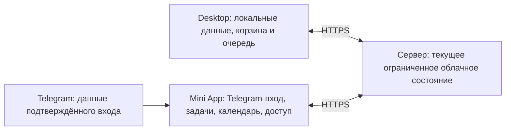

# Синхронизация и Telegram — схема T41a

Статус: **основные решения согласованы 26 ноября 2026**. Пользователь принял
HTTPS без сквозного шифрования, категории и первичное объединение с backup/
предпросмотром; затем уточнил вход и минимальное хранение. Это проект контракта,
не реализованный сервер, аудит или развёртывание. Прежний вариант с одноразовым
кодом привязки и облачной корзиной заменён правилами ниже.

## Согласованные решения

- Приложение работает локально без регистрации. Облако добровольно, несколько
  изолированных пользователей, вход в Mini App через существующий Telegram.
- HTTPS/проверка владельца; без сквозного шифрования. Сервер и администратор
  технически могут читать задачи. Приватный Git не скрывает данные от сервера.
- В облако входят задачи, календарь и категории. Первое объединение — локальный
  backup, предпросмотр и выбор при совпадающих UUID с разным содержимым.
- В Mini App выдаются индивидуальные логин/пароль **Ритма**, пароль можно
  регенерировать. Это не ник/пароль Telegram, не телефон или почта.
- В облаке все активные задачи и **50 последних завершённых главных задач**.
  Локальная история не обрезается. Полный корень с подзадачами считается одной
  задачей; ограничение не означает 50 отдельных пунктов.
- Прошедший календарь — **последние 30 дней** (так фиксируется «последний месяц»).
  Будущие/текущие события не удаляются по давности. На компьютере история остаётся.
- Удалённого содержимого и пользовательской корзины на сервере нет. В Mini App
  задача/пункт исчезает, локальная корзина компьютера сохраняется. Сервер хранит
  только небольшие служебные отметки UUID/ревизии без текста для защиты от возврата.
- **Серверных резервных копий нет**: ни ежедневных дампов, ни скрытых архивов.
  Локальные копии «Ритма» сохраняются. При потере серверной БД облако можно
  восстановить лишь из имеющихся локальных данных; ещё не полученное устройствами
  содержимое после утраты сервера восстановить нельзя.

Новые численные настройки сессий/лимитов ниже — предлагаемые значения v1;
это не параметры, заданные Telegram. Размер сервера/домен/бюджет/путь закрытого
репозитория уточняются перед развёртыванием. Согласование не разрешает само
размещение, регистрацию бота, публикацию или загрузку личных данных.

## Границы

Desktop остаётся Python/PySide6/QML/SQLite, не становится сервером.
Предложенный сервер — Python/FastAPI/SQLite с одним процессом приложения и
короткими последовательными транзакциями записи. Перед увеличением нагрузки/
числа процессов нужна отдельная проверка, при необходимости PostgreSQL.
Сервер — отдельный закрытый репозиторий, не backend внутри desktop. Здесь
остаются клиентский контракт/обезличенные проверки. Реальных конфигураций,
БД и секретов в Git нет даже при закрытом доступе. Временный второй компьютер
допустим; пока он выключен, Mini App/синхронизация недоступны, desktop работает
локально. Никакого чтения сообщений Telegram/MCP не вводится.

## Минимальные данные учётной записи

| Храним | Для чего |
| --- | --- |
| Внутренний owner UUID и Telegram user.id | Связь с тем же аккаунтом Telegram и восстановление доступа |
| Случайный логин Ритма | Вход с компьютера без телефона/почты/ника Telegram |
| Хеш пароля с солью/параметрами | Проверка пароля, без хранения его исходного значения |
| Поколение доступа, хеши токенов, сроки/отзывы | Сессии и прекращение старого доступа |
| Случайные ID устройств, необязательные пользовательские названия | Список подключений и их отзыв, без аппаратного отпечатка |

Telegram ID всё ещё является идентификатором пользователя: это минимизация,
а не обещание анонимности. Не запрашиваем телефон/email/контакты, не сохраняем
имя, фамилию, username, аватар, язык, подписку и чаты. Полный проверяемый
initData может содержать эти поля: он обрабатывается в памяти, но не сохраняется
целиком в БД/логах. Имя компьютера/пользователя ОС не собирается автоматически.
Рабочие сетевые метаданные нужны для лимитов, но постоянная история IP/полных
HTTP-запросов не ведётся; конфигурацию proxy/logging проверить до размещения.

## Вход и регенерация пароля

1. Mini App передаёт initData в теле HTTPS-запроса. Сервер проверяет официальный
   алгоритм Telegram и auth_date, затем берёт user.id. Нет корректного user/id —
   отказ. initDataUnsafe/присланному отдельно owner не доверяет; токен бота только
   на сервере, не в JavaScript/desktop.
2. Предложенный срок initData — 5 минут, будущее смещение до 30 секунд. Дубликаты
   параметров и повтор нормализованного проверенного содержимого отклоняются.
   После входа используется сессия Mini App на 30 минут, токен только в памяти;
   не в URL/localStorage/Telegram CloudStorage. При истечении или повторно
   использованном initData Mini App переоткрывается в Telegram.
3. «Создать доступ для компьютера» выдаёт случайный уникальный логин и пароль
   Ритма. Предложение: логин с 80 битами случайности, пароль с 192 битами (32
   символа Base64url), генератор ОС. Пароль показывается один раз в Mini App,
   не сообщением бота. Пользователь копирует его явно. Ответ без кеширования;
   потерянный пароль нельзя посмотреть заново — только регенерировать.
4. Сервер хранит Argon2id-хеш с уникальной солью. Начальная конфигурация не ниже
   m=19456 KiB, t=2, p=1; окончательно измеряется на целевом сервере. Проверки
   пароля ограничены по частоте и числу одновременных вычислений, чтобы входы
   не исчерпали RAM маленького сервера. SHA-256 вместо password KDF недопустим.
5. Desktop вводит логин/пароль по HTTPS и получает собственные access/refresh.
   Правильный пароль подтверждает владение аккаунтом; дополнительный одноразовый
   код и сравнение отпечатка из старого предложения v1 не требуются. Неверный
   логин/пароль дают одинаковый ответ без перечисления существующих аккаунтов.
6. **Предлагаемое правило регенерации:** логин остаётся прежним, старый пароль
   становится недействительным, все прежние desktop-сессии/refresh отзываются
   атомарно с заменой хеша. На компьютерах нужен новый вход. Текущая сессия
   Telegram не отзывается этим действием. Для выпуска/регенерации нужна свежая
   подтверждённая Mini App сессия (до 5 минут от входа); позже переоткрыть её.
7. Desktop не сохраняет пароль после обмена. Access 15 минут, refresh до 30 дней
   бездействия/90 дней от входа, ротация, проверка отзыва при каждом запросе.
   Refresh только в проверенном vault ОС; без него — память до закрытия. Потеря
   ответа ротации может потребовать нового входа, но не удаления локальных задач.

Секреты не переносятся redirect-ом на другой origin, адрес сервера показывается
до входа. Пароль/токены не входят в backup задач. Mini App показывает устройства
и позволяет отозвать отдельное/все подключения. Отзыв не стирает уже скачанные
локальные копии. Другому Telegram-аккаунту нужен отдельный профиль или отдельный
подтверждённый перенос, без автоматической загрузки чужих локальных задач.

## Облачная проекция данных и очистка

### Задачи

Передаётся только текущий корень: UUID/название/описание, выполнение, сложность,
ожидаемая длительность/дедлайн, category_id, порядок/UUID/веса веток и пунктов.
**Локальные trash.before/after, удалённые узлы и их текст не отправляются.**
Удаление корня — операция с UUID/основанием без старого дерева. При удалении
пункта передаётся обновлённое дерево без него и служебные удалённые UUID.

Для новых облачных завершений порядок последних 50 определяется серверным
номером перехода «не выполнено → выполнено». Переименование выполненной задачи
не делает её новой завершённой; повтор op_id не сдвигает порядок. Повторное
открытие задачи выводит её из лимита завершённых. Начальный импорт использует
доступные task_completion_dates/list_completion_dates и предпросмотр отбора;
для записей без даты завершения дата не выдумывается, пользователь видит
неопределённость и может выбрать состав до отправки.

Превышение 50 удаляет из облака содержимое самых старых завершённых корней.
Desktop получает reason=retention, сохраняет своё дерево/историю/локальные
файлы, не отправляет его обратно обычным refresh. Mini App больше не имеет
эту историю. Явное повторное открытие такого локального корня может вернуть
его в активные через отдельную операцию, старый снимок — нет.

### Календарь

Сохраняются будущие/текущие интервалы и те, чей конец не раньше server_now UTC
минус 30 суток. Старые записи уходят из облака с reason=retention, а не командой
удаления локальной истории. Самостоятельное событие содержит название; рабочий
блок — связь с корнем. Пересечения сохраняются с обычным предупреждением,
не разрешаются автоматическим удалением соседнего события.

Если завершённый корень вышел из лимита 50, но его блок ещё входит в окно
календаря, блок сохраняется с минимальной ссылкой/подписью задачи для показа.
Полное дерево/описание этой старой задачи не хранятся. На устройстве с локальным
корнем блок остаётся связан с ним; Mini App показывает интервал без открытия
недоступного дерева. Эта календарная подпись — часть данных календаря, не
скрытая дополнительная копия завершённой задачи.

При явном удалении корня его связанные блоки также исчезают из облака, включая
подписи; локальный desktop сохраняет свою корзину/скрытые блоки для восстановления.
Окончательная локальная очистка файлов не является автоматическим эффектом
получения облачной отметки. Самостоятельный удалённый блок не хранит содержимое
на сервере; новой облачной корзины календаря нет.

### Удаление и восстановление

Различаются reason=user_deleted (запрос удаления) и reason=retention (конец
облачного хранения). Первая отметка убирает активную задачу в **локальную**
корзину устройства, у которого есть её текст. Вторая не удаляет локальные
данные. Если устройство никогда не получало задачу, сервер не может передать
ему удалённый текст или восстановить его из несуществующей облачной корзины.

Восстановление возможно из локальной корзины: явная операция несёт восстановленное
дерево и актуальное основание, сервер не хранит старый текст ради restore.
Обычный устаревший снимок не эквивалентен восстановлению. Минимальная отметка
содержит owner/UUID/ревизию/поколение удаления/причину, без названия, описания,
снимков, файлов и тела удалённых задач/пунктов. Служебные ID не показываются
пользователю как история удалённых задач.

Категории — UUID/название. Их удаление обнуляет ссылки в корнях атомарно;
устаревшая ссылка не создаёт категорию заново. Проверяется владелец каждой
связи/сущности. Фокус/сад/валюта/материалы/ИИ/настройки/учётные данные не
синхронизируются. Ссылки внутри описания — часть выбранного текста; отдельные
служебные Gmail source_links/данные писем и имена вложений исключены.

## Место и надёжность

- На сервере одна актуальная проекция сущности, без полной истории версий,
  содержимого корзины, дампов и серверных резервных копий.
- Квитанция операции содержит op_id/устройство/хеш запроса/результат/ревизию,
  **не payload или старый текст**. Журнал изменений — служебный индекс текущих
  версий/отметок, не второй архив всех снимков. Истёкшие сессии и временные
  ограничения очищаются; логи ограничены сроком/объёмом и не содержат тел задач,
  паролей/initData или переписки.
- Квитанции и минимальные отметки удаления пока не удаляются произвольно: иначе
  старый повтор/устройство может вернуть удалённое. Их размер также нужно
  учитывать; конечное место нельзя гарантировать одним лимитом «50 задач».
- Удаление SQL-строки само по себе не гарантирует уменьшения файла БД. Нужны
  обслуживание свободных страниц, контроль WAL/временных файлов и замер объёма
  на целевой SQLite; это будущая проверка, не выполненное освобождение диска.
- Активные задачи/будущие события могут занимать место независимо от истории.
  Общую квоту аккаунта/сервера определить по замерам до размещения; при достижении
  квоты сообщать об отказе синхронизации, не удалять активные данные молча.
- Физическое стирание остатков на SSD не обещается мгновенно. Текст отсутствует
  в прикладном хранилище/истории после очистки, но режим SQLite/WAL и его сроки
  очистки нужно реализовать/проверить до использования личных данных.
- Если сервер потерян/переустановлен, меняется его поколение. Клиенты не считают
  пустой новый сервер приказом удалить локальные задачи. Telegram-регистрация
  и доступ создаются заново, выбранные локальные данные импортируются с backup/
  предпросмотром. Пароли/сессии и данные, существовавшие только в утраченном
  облаке, восстановлению без копии не подлежат.

## Ревизии, очередь и защита от повторов

Обычные правки одного корня/события: последняя принятая сервером побеждает.
Порядок не определяется часами устройств. Подзадача меняет весь текущий корень,
но разные корни/события не перезаписывают друг друга. Новый op_id с другим
содержимым — новая операция; тот же op_id+хеш — прежняя квитанция без повторного
применения; тот же op_id с другим хешем отклоняется. Проверка квитанции после
сессии/owner и до проверки текущей ревизии, без возврата старого тела задачи.

Барьер удаления увеличивается при удалении/восстановлении корня или потомка.
Старое основание отклоняется; нельзя автоматически переписать его на новое
и отправить прежнее дерево. UUID удалённых сущностей не переиспользуются
обычной create/put. Явное восстановление/возврат из retention — отдельные
проверяемые действия владельца. Отклонённая операция остаётся для решения,
не исчезает из очереди без решения пользователя.

Локальная правка и outbox — одна транзакция tasks.sqlite3, без токенов.
Операция заморожена с op_id, устройством/поколением, UUID/типом сущности,
основанием и допустимым payload; удаление не кладёт туда прежний текст.
Отправка по исходному порядку, retry/backoff, повтор по тому же op_id.
Серверный снимок и ещё не подтверждённые локальные правки разделены;
входящие данные не создают исходящие операции и не затирают ожидающий ввод.
Курсор/квитанции/данные страницы применяются атомарно, старые ревизии не
откатывают более новые. Все эффекты связанного изменения выдаются согласованно.

Для экономии места сервер не сохраняет скрытые текстовые снимки ради пагинации.
Предложение v1: чтение страниц привязано к ревизии набора; если она изменилась,
клиент отбрасывает только временный получаемый набор и повторяет ограниченное
число раз, сохраняя свою очередь/данные. Это должно быть проверено на гонках.
При устаревшем/чужом курсоре нужен согласованный resync, не перезапись общей БД.

Обычный локальный backup сохраняется; outbox/служебные облачные снимки/курсоры
очищаются **только в создаваемой копии**, пароль/токены/привязки туда не входят.
После restore нужен повторный просмотр облачного состояния, а не запуск
старой очереди. Возвращённое из retention не стирает локальную историю.
Учёт новых выполнений с другого устройства для сада требует отдельной
согласованной политики до inbound T41c; повторные награды при первичном
импорте/resync не допускаются. Удаление из облака сохраняет локальную корзину
и её управляемые вложения; удалять файлы может отдельная локальная очистка,
а не очистка облачной истории. Эта локальная очистка не стирает корзины других
устройств и не вводит новую серверную копию удалённого.

## Предлагаемые ограничения и этапы

Только HTTPS с проверенным сертификатом, Origin/CORS/CSP для Mini App,
отображение текста без HTML, белые схемы/поля и owner из сессии. Предложенные
пределы: до 50 операций/2 МиБ на пакет (сверить с действующими максимальными
деревьями, не обрезать данные), auth — 5 попыток в минуту по логину/IP,
sync — 60 запросов в минуту на устройство с burst 10. Argon2 вычисления
ограничиваются независимо от счётчика попыток. Секреты вне Git/log/папки
публикации. Смена/удаление учётной записи не смешивает пользователей.

| Этап | Готовность |
| --- | --- |
| T41b | Строгий клиентский DTO/точность чисел/времени, обезличенные контракты без trash и причины удаления/retention, SYNC01–SYNC18 |
| T41c | Outbox/inbox/backup desktop; согласовать сад; сохранить локальные файлы/корзину, проверить restart/restore |
| T41d | Сервер в отдельном закрытом репозитории: Telegram/логин/Argon2id/регенерация, изоляция/ревизии/50 задач/30 дней, без серверных копий |
| T41e | Desktop UI/vault Linux+Windows, явный доступ и его отзыв, resync/конфликты/лимиты на подменах |
| T42 | Mini App: задачи/календарь, выпуск логина/пароля и отзыв устройств; публикация/бот отдельно |

## Будущие проверки, ещё не выполнены

SYNC01: Telegram подпись/срок/повторы/дубликаты/отсутствие user;
SYNC02: случайный уникальный логин/пароль, показ один раз, только хеш;
SYNC03: чужая/устаревшая сессия регенерации, новый пароль и отзыв старых сессий;
SYNC04: чужие UUID/курсоры/связанные сущности/receipt;
SYNC05: ротация/replay refresh/отзыв устройства и новый вход;
SYNC06: повтор op_id с тем же/другим содержимым без хранения тела;
SYNC07: разные/одинаковые корни и правки второго уровня;
SYNC08: удаление/локальное восстановление/purge и старый снимок;
SYNC09: категория/связанные блоки/атомарность;
SYNC10: обрыв до/после commit, очередь/повторы/порядок;
SYNC11: страницы/курсор/гонки и сохранение pending-правок;
SYNC12: локальный backup/restore/новое поколение сервера, без облачных копий;
SYNC13: отсутствие удалённого текста/вложений/фокуса/ИИ-секретов в DTO/логах;
SYNC14: первый импорт/смена аккаунта/отсутствующий vault/недоступный сервер;
SYNC15: 49/50/51 завершение, edit/reopen/повтор и импорт с неизвестной датой;
SYNC16: граница 30 дней, текущие/будущие события и блоки старой задачи;
SYNC17: retention не удаляет локальную историю, user_deleted сохраняет локальную корзину;
SYNC18: размер БД/WAL/временных файлов, очистка сессий и отсутствие серверных дампов.

## Источники и статус проверки

Сверено с S16, Task/Subtask/WorkBlock, codec локальной корзины и
TaskStore.list_completion_dates/_write_task/archive_node/restore_entry.
- [Telegram initData](https://core.telegram.org/bots/webapps#validating-data-received-via-the-mini-app).
- [Telegram WebAppUser](https://core.telegram.org/bots/webapps#webappuser).
- [OWASP Password Storage / Argon2id](https://cheatsheetseries.owasp.org/cheatsheets/Password_Storage_Cheat_Sheet.html).
- [OWASP Session Management](https://cheatsheetseries.owasp.org/cheatsheets/Session_Management_Cheat_Sheet.html).
- [FastAPI deployment](https://fastapi.tiangolo.com/deployment/concepts/).
- [SQLite: свободные страницы и VACUUM](https://www.sqlite.org/lang_vacuum.html).

Документ фиксирует согласованный объём и предлагаемые технические настройки,
не доказывает безопасность/малый размер готового сервера. Реальных учётных
записей, паролей, бота, облачного сервера и отправки пользовательских задач нет.
